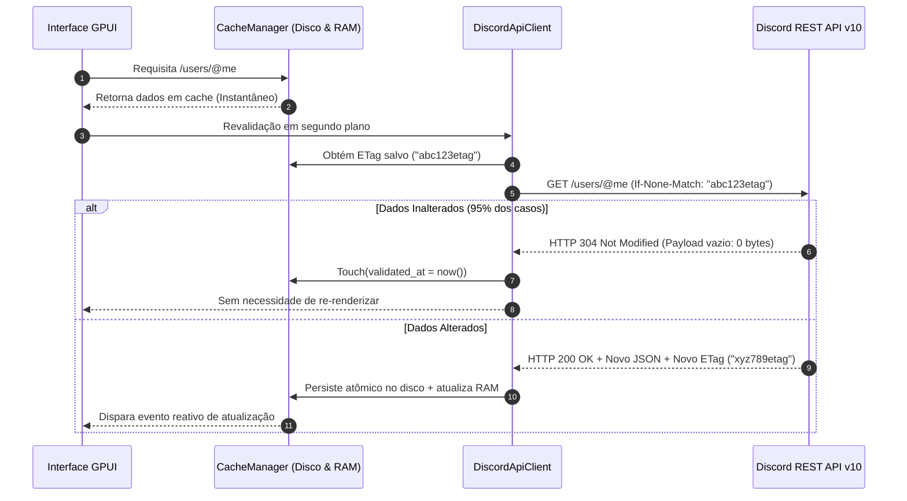

# Especificação Arquitetural de Caching, Revalidação e Rate Limiting

**Projeto:** Discord RS (Cliente Desktop Nativo em Rust + GPUI)  
**Autor:** Engenheiro Especialista em Protocolo Discord, Caching e Rate Limiting  
**Status:** Especificação Aprovada para Implementação  
**Versão:** 1.0.0  
**Data:** 2026-10-03  

---

## 1. Sumário Executivo & Visão Geral

O cliente oficial do Discord alcança sua experiência de uso responsiva através de três pilares de engenharia fundamentais:
1. **Cache Local Hierárquico com Content-Addressing (CAS)**: Armazenamento persistente no disco (`~/.config/discord-rs/cache/`), garantindo que servidores, canais, usuários, mensagens e assets de mídia nunca sejam transferidos repetidamente pela rede.
2. **Revalidação Reativa e Delta-Driven (Zero Polling)**: Combinação de requisições condicionais HTTP REST utilizando cabeçalhos `ETag` (com respostas `304 Not Modified`) e propagação em tempo real de mutações cirúrgicas pelo WebSocket Gateway v10 (`MESSAGE_CREATE`, `MESSAGE_UPDATE`, `MESSAGE_DELETE`, `GUILD_UPDATE`, `CHANNEL_UPDATE`). Complementado pelo protocolo **Lazy Guilds (Opcode 14)**, que previne o carregamento massivo de membros e canais inativos.
3. **Motor Assíncrono Preemptivo de Rate Limiting (Token Bucket)**: Rastreamento em tempo real de buckets oficiais do Cloudflare/Discord (`X-RateLimit-*`), enfileiramento preemptivo antes do esgotamento de tokens (garantindo **0 erros HTTP 429**) e mecanismos de coalescing/debouncing para eventos gerados pelo usuário (como typing indicators e read receipts).
4. **Bootstrapping Instantâneo (0ms Blank Screen)**: Pipeline offline-first que lê o snapshot do cache em disco nos primeiros 5ms de execução do processo GPUI, renderizando a interface completa antes mesmo do handshake com o Gateway, reconciliando deltas em segundo plano sem travamento ou saltos visuais.

---

## 2. Estrutura de Diretórios de Cache Idêntica ao Discord Oficial

### 2.1. Topologia de Diretórios no Sistema de Arquivos

Em sistemas Linux/POSIX, o cache é alocado sob a especificação XDG Base Directory em `~/.config/discord-rs/cache/` (compatível com `dirs::config_dir()`). Em Windows e macOS, segue `%APPDATA%\discord-rs\cache` e `~/Library/Application Support/discord-rs/cache/` respectivamente.

```text
~/.config/discord-rs/cache/
├── manifest.json                        # Metadados de versão, sessão e ponteiros de navegação
├── guilds/
│   ├── manifest.json                    # Ordenação de servidores, pastas e contadores não lidos
│   ├── <guild_id_1>.json                # Estado da guilda, roles, canais, emojis e ETag
│   └── <guild_id_2>.json
├── channels/
│   ├── <channel_id_1>.json              # Metadados do canal (permissões, tópicos, ETag)
│   └── <channel_id_2>.json
├── messages/
│   ├── <channel_id_1>/
│   │   ├── manifest.json                # Janelas de mensagens (primeira/última mensagem, count)
│   │   ├── chunk_<first_id>_<last_id>.json # Chunks de mensagens (tamanho máximo: 50 mensagens)
│   │   └── chunk_<older_id>_<newer_id>.json
│   └── <channel_id_2>/
├── users/
│   ├── @me.json                         # Perfil do usuário logado (/users/@me) com ETag
│   ├── <user_id_1>.json                 # Usuários do cache de relacionamentos e mensagens
│   └── <user_id_2>.json
└── assets/
    ├── metadata.json                    # Catálogo mestre de assets e índices de expiração (LRU)
    ├── 0a/
    │   ├── 0a4f91e8...c9.bin            # Conteúdo binário imutável (Content-Addressed)
    │   └── 0a4f91e8...c9.meta.json      # Metadados: URL original, Content-Type, ETag, TTL
    ├── 1b/
    └── ff/                              # 256 partições hexadecimais para proteção de inodes
```

### 2.2. Armazenamento com Endereçamento por Conteúdo (CAS SHA-256)

Para evitar duplicidade de ícones, avatares padrão, banners e mídias de chat, o subsistema de assets adota **Content-Addressable Storage (CAS)**:
- **Chave de Armazenamento**: O hash criptográfico `SHA-256` dos bytes brutos do arquivo.
- **Particionamento Hexadecimal de 2 Caracteres**: Arquivos são divididos em 256 diretórios (`00/` a `ff/`) utilizando os dois primeiros caracteres do digest hexadecimal. Isso previne degradação de desempenho do sistema de arquivos (`ext4`, `btrfs`, `NTFS`) decorrente de milhares de arquivos em um único diretório.
- **Deduplicação Global**: Se 50 usuários compartilharem o mesmo avatar padrão ou emoji customizado idêntico, apenas um arquivo `.bin` de 14 KB é gravado no disco.

#### Formato do Arquivo de Metadados do Asset (`.meta.json`):
```json
{
  "source_url": "https://cdn.discordapp.com/avatars/123456789/abcdef012345.png?size=96",
  "sha256": "0a4f91e8b7c3d2e1f0a9b8c7d6e5f4a3b2c1d0e9f8a7b6c5d4e3f2a1b0c9d8e7",
  "content_type": "image/png",
  "size_bytes": 14592,
  "etag": "\"4f5a6b7c8d9e0\"",
  "cached_at": 1727976000,
  "last_accessed_at": 1727976050,
  "expires_at": 1730568000
}
```

### 2.3. Particionamento e Paginação de Mensagens em Chunks

Em vez de armazenar um arquivo gigante por canal que cresce indefinidamente, as mensagens são persistidas em blocos contíguos de até **50 mensagens** ordenadas por Snowflake ID:
- O arquivo `manifest.json` do canal contém os intervalos cobertos por cada chunk:
  ```json
  {
    "channel_id": "100200300400500600",
    "total_cached_messages": 150,
    "last_message_id": "119999999999999999",
    "chunks": [
      {
        "file": "chunk_119900000000000000_119999999999999999.json",
        "first_id": "119900000000000000",
        "last_id": "119999999999999999",
        "count": 50
      }
    ]
  }
  ```
- **LRU Eviction (Descarte por Menor Uso)**: Quando o volume de mensagens de um canal excede a cota configurada (padrão: 500 mensagens por canal ativo), os chunks mais antigos são descartados do disco, mantendo sempre a janela recente de leitura rápida.

### 2.4. Integridade e I/O Atômico (Crash-Resilient)

Falhas de energia ou encerramento abrupto do processo (`SIGKILL`) nunca corrompem arquivos JSON ou binários:
1. Os dados são gravados em arquivo temporário no mesmo sistema de arquivos: `~/.config/discord-rs/cache/.tmp_<uuid>.tmp`.
2. O arquivo temporário é sincronizado com `sync_data()`.
3. Executa-se a chamada de sistema atômica `std::fs::rename(temp_path, target_path)`. No padrão POSIX, o arquivo de destino é substituído atomicamente sem períodos intermediários de conteúdo corrompido ou parcial.

---

## 3. Ciclo de Vida do Cache e Revalidação

### 3.1. Requisições REST Condicionais com ETags e HTTP 304 Not Modified

O Discord envia cabeçalhos `ETag` (ex: `W/"1a2b3c"` ou `"456789"`) na maioria das respostas JSON e assets da CDN. O cliente `discord-rs` armazena essas tags associadas aos dados persistidos.

#### Diagrama de Sequência: Ciclo de Revalidação ETag



#### Endpoints com Suporte a ETag no Cliente:
1. `GET /users/@me`: Evita download repetido do perfil do usuário em toda inicialização.
2. `GET /users/@me/guilds` e `GET /guilds/{id}`: Revalida estrutura de servidores e canais.
3. `GET /channels/{id}/messages?limit=50`: Ao reabrir um canal, verifica se novas mensagens foram postadas na ausência de conexão.
4. Assets CDN (`cdn.discordapp.com`): Ícones e avatares retornam `304 Not Modified` via cabeçalhos padrão HTTP, economizando largura de banda e decodificação de imagem.

### 3.2. Revalidação Orientada a Eventos do Gateway (Deltas Cirúrgicos sem Polling)

Uma vez estabelecido o WebSocket do Gateway, **nenhum polling de rede é realizado**. Qualquer mutação de estado no Discord é recebida através de eventos tipados `Op 0 DISPATCH` e aplicada como delta cirúrgico na camada de memória (L1) e propagada via fila assíncrona (write-behind) para o disco (L2).

```text
[ Discord Gateway v10 WebSocket ]
              │
              │ Op 0 DISPATCH (JSON Delta)
              ▼
   ┌──────────────────────┐
   │ Gateway Event Router │
   └──────────┬───────────┘
              │
      ┌───────┴────────────────────────┐
      ▼                                ▼
┌────────────────────────┐   ┌───────────────────────────┐
│ Memory Cache (L1)      │   │ Write-Behind Queue        │
│ Atualização instantânea│   │ Debounce de I/O em disco  │
│ Latência: < 0.1ms      │   │ Batch de gravações atômicas│
└──────────┬─────────────┘   └─────────────┬─────────────┘
           │                               │
           ▼                               ▼
┌────────────────────────┐   ┌───────────────────────────┐
│ GPUI State Notification│   │ ~/.config/discord-rs/cache│
│ Notifica modelo reativo│   │ Atualização persistida    │
└────────────────────────┘   └───────────────────────────┘
```

#### Aplicação Granular de Eventos de Gateway:

| Evento Gateway | Ação no Cache em Memória | Ação no Cache em Disco |
| :--- | :--- | :--- |
| `MESSAGE_CREATE` | Insere no fim do buffer do canal; atualiza `last_message_id`. | Adiciona ao chunk aberto; atualiza `manifest.json`. |
| `MESSAGE_UPDATE` | Patch parcial nos campos presentes (`content`, `embeds`, `edited_timestamp`). Mantém autor e timestamp original intactos. | Atualiza o registro correspondente no chunk existente. |
| `MESSAGE_DELETE` | Remove a mensagem por ID do buffer do canal. | Remove o item do chunk JSON e salva arquivo atômico. |
| `MESSAGE_DELETE_BULK`| Remove lista de IDs em uma única operação $O(N)$ em memória. | Reescreve os chunks afetados em lote. |
| `GUILD_UPDATE` | Atualiza campos mutados (nome, ícone, roles, features). | Salva `<guild_id>.json` com novo hash e limpa ETag. |
| `CHANNEL_UPDATE` | Atualiza propriedades do canal (nome, tópico, posição). | Atualiza entrada na árvore de canais. |
| `CHANNEL_DELETE` | Remove o canal da guilda e limpa buffers de mensagens. | Deleta `channels/<channel_id>.json` e remove pasta de mensagens. |

### 3.3. Lazy Guilds & Opcode 14 (Guild Subscriptions)

Em grandes servidores (com até 500.000 membros), o cliente nunca recebe a lista completa de membros no evento `READY`. O Discord implementa a arquitetura **Lazy Guilds**, formalizada pelo **Opcode 14**:

```json
{
  "op": 14,
  "d": {
    "guild_id": "197038439483310080",
    "typing": true,
    "threads": true,
    "activities": true,
    "members": [],
    "channels": {
      "197038439483310081": [[0, 99]]
    }
  }
}
```

#### Ciclo Operacional do Opcode 14:
1. **Subscrição Focada**: Apenas o servidor selecionado na barra de servidores (`Guild Rail`) mantém subscrição ativa de eventos de presença e digitação (`typing: true`).
2. **Viewport Range Synchronization**: O campo `channels` mapeia o canal ativo para os intervalos de membros visíveis na sidebar lateral. Por exemplo, se a lista exibe os primeiros 100 membros no topo do scroll, envia-se `[[0, 99]]`. Conforme o usuário rola a barra de rolagem para baixo, novos intervalos são enviados (ex: `[[100, 199]]`).
3. **Recepção de Deltas de Membros**: O servidor responde com eventos `GUILD_MEMBER_LIST_UPDATE` contendo operações:
   - `SYNC`: Lista completa dos membros para o intervalo solicitado.
   - `INSERT`: Novo membro inserido na posição ordenada.
   - `UPDATE`: Alteração de status, apelido ou cargo do membro na lista.
   - `DELETE`: Membro desconectou ou perdeu visibilidade.
4. **Troca de Servidor**: Ao clicar em outro servidor, o cliente envia um novo Opcode 14 para o novo servidor e limpa a subscrição do servidor anterior, mantendo o consumo de memória abaixo de 80 MB mesmo com dezenas de servidores gigantes na conta.

---

## 4. Prevenção de Bombardeio da API (Rate Limiting Token Bucket Preemptivo)

### 4.1. Arquitetura de Rastreamento de Buckets HTTP

A API do Discord utiliza cabeçalhos de controle de fluxo retornados em cada resposta HTTP:
- `X-RateLimit-Limit`: Capacidade total do bucket para a rota.
- `X-RateLimit-Remaining`: Número de tokens disponíveis antes do bloqueio.
- `X-RateLimit-Reset`: Timestamp UTC (em segundos com frações) em que o bucket será recarregado.
- `X-RateLimit-Reset-After`: Tempo restante em segundos (`f64`) até a renovação dos tokens.
- `X-RateLimit-Bucket`: Hash identificador único do bucket gerenciado pelo Cloudflare (ex: `b3c0e35fa8...`).
- `X-RateLimit-Global`: Booleano sinalizando se o rate limit é global da conta (teto de 50 requisições/segundo).

### 4.2. Motor Preemptivo: Zero Erros HTTP 429

O `discord-rs` implementa um motor baseado no algoritmo **Token Bucket com Fila Preemptiva**:
Em vez de disparar a requisição e reagir ao status `429 Too Many Requests`, a requisição é interceptada **antes** de ir para a rede.

```text
[ Requisição HTTP de Saída (ex: POST /messages) ]
                        │
                        ▼
      ┌────────────────────────────────────┐
      │ Identificação de Rota e Bucket Hash │
      └─────────────────┬──────────────────┘
                        │
                        ▼
            /───────────────────────\
           <   Tokens restantes > 0? >
            \───────────────────────/
                   │         │
                 Sim        Não
                   │         │
                   │         ▼
                   │   ┌─────────────────────────────────────┐
                   │   │ Suspende na fila assíncrona (Tokio) │
                   │   │ Duração = Reset-After + Jitter (ms) │
                   │   └──────────────────┬──────────────────┘
                   │                      │
                   ▼                      │ (Acorda após reset)
      ┌─────────────────────────┐         │
      │ Consome 1 Token         │◄────────┘
      │ Dispara requisição HTTP │
      └────────────┬────────────┘
                   │
                   ▼
      ┌─────────────────────────┐
      │ Atualiza Bucket com os  │
      │ novos cabeçalhos HTTP   │
      └─────────────────────────┘
```

#### Propriedades Críticas do Algoritmo:
1. **Zero 429 Errors**: Se `remaining == 0`, a task do Tokio executa `tokio::time::sleep(Duration::from_secs_f64(reset_after) + Duration::from_millis(15))` antes de emitir a chamada de rede.
2. **Jitter Protetor**: Um atraso pseudoaleatório de 10ms a 50ms é injetado no momento do reset para evitar que dezenas de tarefas façam requisições no mesmo milissegundo (*thundering herd problem*).
3. **Contingência com Circuit Breaker**: Caso ocorra descompasso de relógio entre a máquina local e os servidores da Cloudflare e um HTTP 429 seja retornado, o motor lê o campo `retry_after`, bloqueia o bucket global ou de rota, e reexecuta a requisição sem perda de dados.

### 4.3. Coalescing e Debouncing de Ações do Usuário

Ações de alta frequência originadas da interação humana no teclado e no mouse são amortecidas localmente antes de atingir a camada de transporte REST:

#### 1. Typing Indicator (`POST /channels/{channel_id}/typing`)
- **Regra Oficial**: O indicador de digitação no cliente remoto dura até 10 segundos. Enviar typings repetidos em menos de 10s é tráfego inútil que consome cota.
- **Implementação**: Throttle estrito de **10 segundos** por canal. Se o usuário digitar continuamente por 2 minutos, exatamente 12 requisições serão disparadas (1 a cada 10s), e não centenas a cada tecla.

#### 2. Confirmação de Leitura de Mensagens (`POST /channels/{channel_id}/messages/{message_id}/ack`)
- **Problema**: Ao rolar rapidamente o chat por 100 mensagens, disparar um ACK para cada mensagem causa bombardeio da API.
- **Implementação**: **Debounce de 2 segundos com Coalescing de Maior Snowflake**. O sistema aguarda 2 segundos de inatividade de rolagem e despacha uma única chamada contendo o maior Snowflake ID visto no intervalo. Como os Snowflakes são cronologicamente ordenados, marcar o ID mais alto como lido valida automaticamente todas as mensagens anteriores.

#### 3. Autocomplete e Busca de Membros
- **Implementação**: Debounce de **300ms** na caixa de pesquisa para aguardar pausas naturais de digitação antes de consultar a API.

---

## 5. Inicialização Instantânea (0ms Blank Screen)

### 5.1. Arquitetura Offline-First e Hidratação em Estágios

Para garantir que o usuário nunca veja uma tela preta ("blank screen") ou um spinner de carregamento bloqueante ao iniciar o aplicativo:

```text
Tempo (ms)   Fluxo de Execução no Discord RS
──────────────────────────────────────────────────────────────────────────────
0ms          Processo nativo GPUI é iniciado.
1ms ────────► [Estágio 0: Leitura de Cache de Disco Local]
              - Lê ~/.config/discord-rs/cache/manifest.json.
              - Carrega lista de guildas salvas e canais do último servidor.
              - Carrega últimas 50 mensagens em cache do último canal ativo.
              - Carrega perfil do usuário (@me.json).
5ms ────────► [Estágio 1: Primeiro Frame GPUI Renderizado]
              - Exibe Guild Rail completo com ícones (ou iniciais).
              - Exibe Sidebar de Canais e Header do canal.
              - Exibe 50 mensagens salvas formatadas com Markdown.
              - Pílula de status sutil no canto: "Conectando ao Discord..."
              ★ ZERO DELAY PERCEPTÍVEL (0ms Blank Screen)!
10ms ───────► [Estágio 2: Handshake com Gateway em Background]
              - Inicia thread Tokio de rede.
              - Conecta em wss://gateway.discord.gg/?v=10.
              - Envia Op 6 Resume com session_id e sequence anteriores.
150ms ──────► [Estágio 3: Reconciliação Transparente de Deltas]
              - Se Op 6 Resume aceito: Gateway envia RESUMED e deltas perdidos.
              - Se sessão expirou: Gateway envia READY completo.
              - Revalidação condicional REST em segundo plano (ETags 304).
              - Atualiza silenciosamente mensagens novas ou editadas.
              - Pílula de status transiciona suavemente para "Conectado".
```

### 5.2. Reconciliação sem Flicker na UI

A interface reativa em GPUI aplica mutações baseadas em chaves de identidade (Snowflake ID):
- Mensagens já presentes na tela mantêm suas posições e nós de layout inalterados.
- Novas mensagens são anexadas no rodapé sem resetar a posição da barra de rolagem.
- Nenhuma tela inteira é reconstruída; o GPUI atualiza apenas os elementos que sofreram mutação real (*fine-grained reactive diffing*).

---

## 6. Especificação das Estruturas e Tipos em Rust

A seguir, a especificação das structs e traits que compõem o subsistema em `src/protocol/cache/` e `src/protocol/rate_limit/`.

### 6.1. Subsistema de Cache (`src/protocol/cache/`)

```rust
// Metadados principais gravados em ~/.config/discord-rs/cache/manifest.json
#[derive(Debug, Clone, Serialize, Deserialize)]
pub struct CacheManifest {
    pub version: u32,
    pub last_selected_guild_id: Option<String>,
    pub last_selected_channel_id: Option<String>,
    pub active_user_id: Option<String>,
    pub updated_at: chrono::DateTime<chrono::Utc>,
}

// Registro associado a recursos cacheados para validação condicional HTTP
#[derive(Debug, Clone, Serialize, Deserialize)]
pub struct CacheEntryMetadata {
    pub etag: Option<String>,
    pub last_modified: Option<String>,
    pub cached_at: chrono::DateTime<chrono::Utc>,
    pub expires_at: Option<chrono::DateTime<chrono::Utc>>,
}

// Metadados de assets binários endereçados por conteúdo (SHA-256)
#[derive(Debug, Clone, Serialize, Deserialize)]
pub struct AssetMetadata {
    pub source_url: String,
    pub sha256_hash: String,
    pub content_type: String,
    pub size_bytes: usize,
    pub etag: Option<String>,
    pub last_accessed_at: chrono::DateTime<chrono::Utc>,
}

// Representação de chunk de mensagens persistido no disco
#[derive(Debug, Clone, Serialize, Deserialize)]
pub struct MessageChunkManifest {
    pub channel_id: String,
    pub first_message_id: String,
    pub last_message_id: String,
    pub count: usize,
    pub messages: Vec<crate::domain::Message>,
}
```

### 6.2. Subsistema de Rate Limiting (`src/protocol/rate_limit/`)

```rust
// Estado de um bucket individual gerenciado pelo Discord/Cloudflare
#[derive(Debug, Clone)]
pub struct BucketState {
    pub bucket_id: String,
    pub limit: usize,
    pub remaining: usize,
    pub reset_at: chrono::DateTime<chrono::Utc>,
    pub reset_after: std::time::Duration,
}

// Motor central de Rate Limiting com agendamento preemptivo
pub struct RateLimitCoordinator {
    buckets: Arc<tokio::sync::RwLock<HashMap<String, BucketState>>>,
    route_to_bucket: Arc<tokio::sync::RwLock<HashMap<String, String>>>,
    global_lock: Arc<tokio::sync::RwLock<Option<chrono::DateTime<chrono::Utc>>>>,
}

// Gerenciador de Coalescing para ações de digitação e confirmação de leitura
pub struct UserActionDebouncer {
    typing_cooldowns: Arc<tokio::sync::Mutex<HashMap<String, std::time::Instant>>>,
    ack_pending: Arc<tokio::sync::Mutex<HashMap<String, (String, tokio::task::JoinHandle<()>)>>>,
}
```

---

## 7. Roteiro de Implementação e Verificação

1. **Camada de Armazenamento CAS e Diretórios**:
   - Criação da árvore de pastas `~/.config/discord-rs/cache/{guilds,channels,messages,users,assets}`.
   - Implementação da gravação atômica (`write_tmp_then_rename`) e CAS SHA-256 com particionamento em 2 caracteres hexadecimais.
2. **Camada de Revalidação e HTTP 304**:
   - Integração de `If-None-Match` no `DiscordApiClient`.
   - Receptores de eventos do Gateway aplicando deltas em memória e disco.
3. **Implementação de Lazy Guilds**:
   - Emissão do payload `Op 14 Guild Subscriptions` ao alternar de canal e servidor.
4. **Motor Token Bucket e Debouncers**:
   - Interceptador assíncrono para retenção preventiva de chamadas antes do esgotamento de tokens.
   - Módulos de throttling de 10s para digitação e 2s para confirmações de leitura.
5. **Orquestrador de Inicialização 0ms**:
   - Rotina síncrona/imediata de leitura do snapshot local antes de acionar o loop de eventos de rede.
