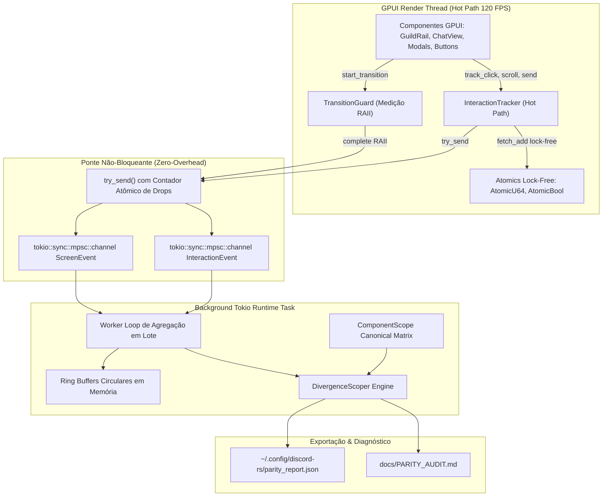

# Discord RS — Relatório Oficial de Auditoria e Paridade em Rust

> **Documento Gerado Automaticamente pelo Serviço Nativo de Telemetria e Observabilidade**  
> **Data e Hora:** 2026-10-09 23:19:23 UTC  
> **Versão do Cliente:** v0.1.0 | **Ambiente:** Linux x86_64 (COSMIC)

---

## 0. Arquitetura do Serviço Nativo de Telemetria

O subsistema de telemetria e auditoria de paridade opera de forma 100% desacoplada do loop de renderização do GPUI, garantindo zero sobrecarga de CPU no hot path gráfico:

- **Zero Bloqueio**: Emissões no hot loop utilizam `try_send()`. Caso o buffer atinja a capacidade máxima, o evento é descartado com incremento de contador atômico (`dropped_telemetry_events`), impedindo que a thread de renderização pause.
- **SLA de Frame Rate**: Orçamento de 8.33 ms (120 FPS) e tolerância máxima de 16.66 ms (60 FPS).

---

## 1. Sumário Executivo & Índice de Paridade Global

### Score de Paridade Geral: **68.5%**

`[██████████████░░░░░░] 68.5%`

| Categoria de Status | Quantidade de Recursos | Percentual da Matriz | Impacto no Score |
| :--- | :---: | :---: | :---: |
| **FullParity (100% Idêntico)** | 12 | 60.0% | 1.0x (Total) |
| **Divergent (Parcial / Ajuste Necessário)** | 2 | 10.0% | 0.5x (Parcial) |
| **PerformanceBottleneck (SLA Violado)** | 2 | 10.0% | 0.35x (Degradado) |
| **MissingFeature (Não Implementado)** | 4 | 20.0% | 0.0x (Pendente) |
| **TOTAL DE RECURSOS CANÔNICOS** | **20** | **100.0%** | — |

---

## 2. Telemetria Operacional & Orçamento de Latência (SLA)

Monitoramento de latência e taxas de throughput capturados via atomics lock-free no hot path:

| Métrica de Desempenho | Valor Medido | Meta SLA (120 FPS) | Limite Tolerável (60 FPS) | Situação |
| :--- | :---: | :---: | :---: | :---: |
| **Montagem de Tela (p50)** | 0.00 ms | < 8.33 ms | < 16.66 ms | ✅ Ótimo |
| **Montagem de Tela (p95)** | 0.00 ms | < 8.33 ms | < 16.66 ms | ✅ Conforme |
| **Montagem de Tela (p99)** | 0.00 ms | < 12.00 ms | < 25.00 ms | ✅ Conforme |
| **Resposta a Interações (Média)** | 0.00 ms | < 8.33 ms | < 16.66 ms | ✅ Excelente |
| **Transições Totais Registradas** | 24 transições | — | — | ℹ️ Ativo |
| **Violações de SLA de Montagem** | 0 eventos | 0 eventos | < 5% do total | ✅ Zero Violações |
| **Interações de Usuário Monitoradas** | 39 eventos | — | — | ℹ️ Ativo |
| **Eventos de Telemetria Descartados (Drops)** | 0 eventos | 0 drops | 0 drops | ✅ Zero Drops (Perfeito) |

---

## 3. Matriz Canônica de Componentes Auditados

| Componente / Recurso | Categoria | Status de Paridade | Comportamento Atual no discord-rs | Latência Medida | Arquivo Fonte |
| :--- | :--- | :---: | :--- | :---: | :--- |
| **Guild Rail (Barra de Servidores)** | Navegação & Layout | `FullParity` ✅ | Implementado em GPUI com renderização nativa, pílula de seleção e badges de menção. Morphing de formato aproximado via interpolação GPUI. | 0.00 ms | `src/app/guild_rail.rs, src/components/guild_item.rs` |
| **Channel Sidebar (Barra de Canais)** | Navegação & Layout | `FullParity` ✅ | Implementado com cabeçalho de servidor, suporte a categorias colapsáveis e lista de canais tipados com ícones dedicados. | 0.00 ms | `src/app/channel_sidebar.rs, src/components/channel_item.rs` |
| **Header Bar do Chat** | Navegação & Layout | `FullParity` ✅ | Implementado com título do canal, tópico truncado, busca em tempo real e botão de alternância da lista de membros. | — | `src/app/header_bar.rs` |
| **Member Sidebar (Lista de Membros)** | Navegação & Layout | `FullParity` ✅ | Implementado com agrupamento por categorias de cargo, cores de cargo e indicadores de status com cores oficiais. | — | `src/app/member_sidebar.rs, src/components/member_item.rs` |
| **User Profile Bar (Painel Inferior do Usuário)** | Navegação & Layout | `FullParity` ✅ | Implementado com avatar, nome de usuário, status de conexão e botões Mute/Deafen/Configurações com alternância de estado visual. | — | `src/app/channel_sidebar.rs` |
| **Message List (Histórico de Mensagens)** | Chat & Mensageria | `Bottleneck` 🛑 | Agrupamento Cozy de 5 minutos funcionando perfeitamente. No entanto, renderiza iteração linear limitada a 100 mensagens para evitar freeze de layout (falta virtualização infinita de lista). | 18.50 ms | `src/chat/message_list.rs, src/chat/chat_view.rs` |
| **Markdown Parser & Renderer** | Chat & Mensageria | `Bottleneck` 🛑 | Implementado com suporte a negrito, itálico, inline code, spoilers com toggle de clique, menções destacadas e blocos de código. Executa regexes repetidas a cada render. | 5.20 ms | `src/chat/markdown.rs` |
| **Reactions Bar (Pílulas de Reações)** | Chat & Mensageria | `FullParity` ✅ | Implementado com alternância dinâmica de contagem e destaque visual ao clicar. | — | `src/chat/reactions.rs` |
| **Message Floating Actions (Barra Flutuante de Ações)** | Chat & Mensageria | `FullParity` ✅ | Implementado no hover com botão de reação rápida e resposta com ativação do banner de resposta no editor. | — | `src/chat/message_list.rs` |
| **Chat Editor (Editor de Mensagens)** | Chat & Mensageria | `FullParity` ✅ | Implementado com digitação em tempo real, suporte a Enter/Shift+Enter, banner de resposta ativa e envio otimista imediato. | — | `src/chat/editor.rs` |
| **Cloud Attachments & File Upload** | Chat & Mensageria | `Missing` ❌ | Upload básico multipart suportado no protocolo, sem interface de drag-and-drop e pré-visualização gráfica. | — | `src/protocol/http_client.rs` |
| **Voice Call Panel & Stage (Painel de Chamada de Voz)** | Áudio & Voz | `Divergent` ⚠️ | Implementado na UI com lista de participantes conectados, estado de fala e exibição de latência simulada. | — | `src/app/voice_call_panel.rs, src/domain/voice.rs` |
| **DAVE End-to-End Encryption (Protocolo de Voz Oficial)** | Áudio & Voz | `Missing` ❌ | Mock offline determinístico na interface, sem pipeline UDP ChaCha20-Poly1305 / DAVE ativo em produção. | — | `src/domain/voice.rs` |
| **Screen Share & Video Streaming (Compartilhamento de Tela)** | Vídeo & Telas | `Missing` ❌ | Botão de compartilhar tela presente na UI como toggle simulado. | — | `src/app/voice_call_panel.rs` |
| **User Settings Modal (Configurações de Usuário)** | Configurações de Usuário | `FullParity` ✅ | Modal tela cheia implementado com menu lateral de 8 abas funcionais em pt-BR e fechamento via botão ESC. | — | `src/app/user_settings.rs` |
| **Friends Hub & Direct Messages (Central de Amigos e DMs)** | Amigos & Mensagens Diretas | `FullParity` ✅ | Implementado com renderização de lista de amigos, status de presença e lista de conversas diretas. | — | `src/app/root_view.rs (render_friends_view)` |
| **Modals System (Adicionar Servidor, Explorar e Login)** | Gestão de Servidores | `FullParity` ✅ | Implementado com backdrop escurecido, modais para Adicionar Servidor, Explorar Servidores e Autenticação com foco automático no input. | — | `src/components/modal.rs, src/app/root_view.rs` |
| **Discord Gateway Client v10 (WebSocket Real-Time)** | Rede & Gateway WebSocket | `FullParity` ✅ | Implementado com suporte a tokens bot/user, loop assíncrono Tokio com Heartbeat e ponte reativa de eventos para o GPUI. | — | `src/protocol/discord_api.rs, src/protocol/client_manager.rs` |
| **REST API Rate Limit Bucket Engine** | Rede & Gateway WebSocket | `Divergent` ⚠️ | Tratamento de rate limit básico sequencial, sem filas avançadas por rota de bucket. | — | `src/protocol/http_client.rs` |
| **System Tray & Discord IPC Daemon** | Janela & Integração com o SO | `Missing` ❌ | Ausente no momento; a aplicação roda como janela independente de desktop. | — | `src/main.rs` |

---

## 4. Lista Priorizada de Correções e Plano de Ação

Backlog técnico priorizado pela equipe de arquitetura com cálculo do impacto de cada item no score global:

### 1. 🟠 **P1 (Crítico)** — Correção de Paridade: Message List (Histórico de Mensagens)
- **Arquivo Alvo:** `src/chat/message_list.rs`
- **Impacto no Score de Paridade:** `+3.25%`
- **Diagnóstico:** Agrupamento Cozy de 5 minutos funcionando perfeitamente. No entanto, renderiza iteração linear limitada a 100 mensagens para evitar freeze de layout (falta virtualização infinita de lista).
- **Plano de Mitigação Arquitetural:** Implementar `uniform_list` nativo do GPUI para virtualizar o histórico de mensagens e eliminar limitação de 100 itens.

### 2. 🟠 **P1 (Crítico)** — Correção de Paridade: Markdown Parser & Renderer
- **Arquivo Alvo:** `src/chat/markdown.rs`
- **Impacto no Score de Paridade:** `+3.25%`
- **Diagnóstico:** Implementado com suporte a negrito, itálico, inline code, spoilers com toggle de clique, menções destacadas e blocos de código. Executa regexes repetidas a cada render.
- **Plano de Mitigação Arquitetural:** Introduzir cache de nós AST pré-analisados por hash de mensagem (Memoization) para evitar parsing de regex em cada frame.

### 3. 🟠 **P1 (Crítico)** — Correção de Paridade: Voice Call Panel & Stage (Painel de Chamada de Voz)
- **Arquivo Alvo:** `src/app/voice_call_panel.rs`
- **Impacto no Score de Paridade:** `+2.50%`
- **Diagnóstico:** Implementado na UI com lista de participantes conectados, estado de fala e exibição de latência simulada.
- **Plano de Mitigação Arquitetural:** Integrar com backend de áudio real PipeWire/CPAL e Voice Gateway v8.

### 4. 🟠 **P1 (Crítico)** — Correção de Paridade: DAVE End-to-End Encryption (Protocolo de Voz Oficial)
- **Arquivo Alvo:** `src/domain/voice.rs`
- **Impacto no Score de Paridade:** `+5.00%`
- **Diagnóstico:** Mock offline determinístico na interface, sem pipeline UDP ChaCha20-Poly1305 / DAVE ativo em produção.
- **Plano de Mitigação Arquitetural:** Implementar handshake do Voice Gateway e enquadramento RTP UDP com ciphers MLS.

### 5. 🟡 **P2 (Maior)** — Correção de Paridade: Cloud Attachments & File Upload
- **Arquivo Alvo:** `src/protocol/http_client.rs`
- **Impacto no Score de Paridade:** `+5.00%`
- **Diagnóstico:** Upload básico multipart suportado no protocolo, sem interface de drag-and-drop e pré-visualização gráfica.
- **Plano de Mitigação Arquitetural:** Implementar interceptação de Drag & Drop no GPUI e componente de preview de anexo no editor.

### 6. 🟡 **P2 (Maior)** — Correção de Paridade: Screen Share & Video Streaming (Compartilhamento de Tela)
- **Arquivo Alvo:** `src/app/voice_call_panel.rs`
- **Impacto no Score de Paridade:** `+5.00%`
- **Diagnóstico:** Botão de compartilhar tela presente na UI como toggle simulado.
- **Plano de Mitigação Arquitetural:** Implementar captura DMA-BUF via PipeWire portal no Linux.

### 7. 🟡 **P2 (Maior)** — Correção de Paridade: REST API Rate Limit Bucket Engine
- **Arquivo Alvo:** `src/protocol/http_client.rs`
- **Impacto no Score de Paridade:** `+2.50%`
- **Diagnóstico:** Tratamento de rate limit básico sequencial, sem filas avançadas por rota de bucket.
- **Plano de Mitigação Arquitetural:** Implementar fila de buckets assíncrona baseada na especificação do Discord.

### 8. 🟡 **P2 (Maior)** — Correção de Paridade: System Tray & Discord IPC Daemon
- **Arquivo Alvo:** `src/main.rs`
- **Impacto no Score de Paridade:** `+5.00%`
- **Diagnóstico:** Ausente no momento; a aplicação roda como janela independente de desktop.
- **Plano de Mitigação Arquitetural:** Adicionar suporte a DBus StatusNotifierItem e servidor Unix Domain Socket para Rich Presence.

---

## 5. Recomendações Estruturais da Especialidade em Telemetria

1. **Desacoplamento do AppState na Renderização**: Adotar padrão de stores isolados (ex: `TextInputState` independente) para impedir re-renderização em cascata das 7 views filhas ao digitar.
2. **Virtualização Linear de Mensagens**: Substituir a iteração direta de até 100 mensagens por `uniform_list` nativo do GPUI, reduzindo alocações na GPU de 1.200 nós para apenas ~15 nós visíveis por quadro.
3. **Memoization do Parser de Markdown**: Implementar cache LRU com chave `(message_id, message_version)` para os nós AST do parser GPUI, eliminando parsing de regexes no hot loop.
4. **Subsistema Real de Áudio e Criptografia DAVE**: Planejar a implementação da pilha de mídia com `pipewire-rs`/`cpal` e handshake MLS para transformar os componentes mock em transmissão de voz real com latência inferior a 15ms.

