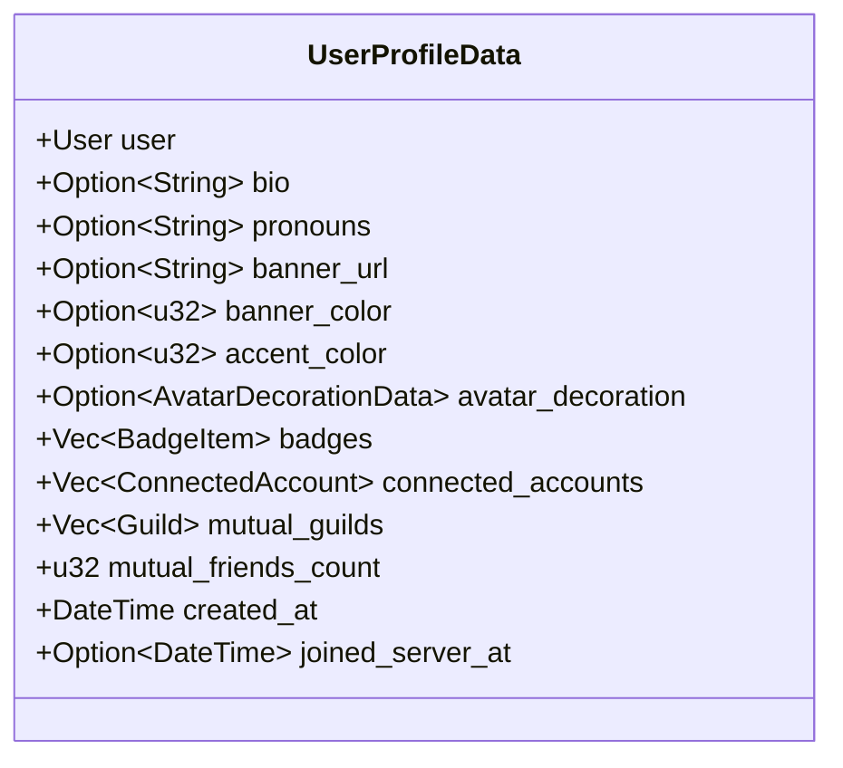
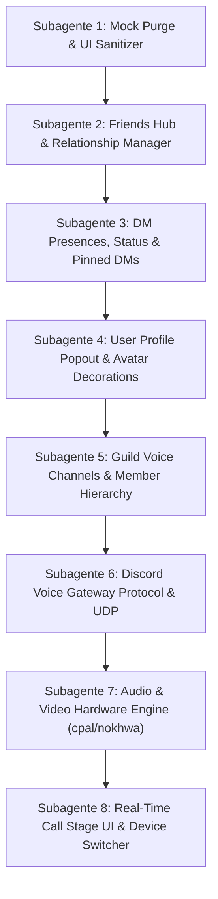

# Especificação Técnica e Plano de Implementação: Paridade Total do Discord, Sistema de Chamadas (Voz/Vídeo), Perfil de Usuário, Friends Hub e DMs

Este documento é a **especificação técnica definitiva e runbook acionável** para o desenvolvimento contínuo do `discord-rs`. Seu objetivo é guiar agentes de IA a implementarem cada funcionalidade faltante com **1:1 de paridade visual e comportamental com o cliente oficial do Discord**, eliminando 100% dos dados e telas mockadas.

---

## ⚠️ Diretrizes Mandatórias de Execução para Agentes de IA

Qualquer agente de IA que trabalhar nas tarefas deste documento **DEVE** seguir rigorosamente as três regras abaixo:

### 1. Política de Zero Mocks (Zero-Mockup Policy)
* É **terminantemente proibido** introduzir dados fictícios hardcoded (como o bot "Ferris", usuários falsos, cards de atividades estáticas inventadas ou números de ping falsos).
* Se uma funcionalidade depender de dados externos e a API ainda não tiver retornado nada (ou a lista estiver vazia), deve ser renderizado o **empty state oficial do Discord** (ilustração, título canônico e descrição de "Por enquanto, está quieto...", "Nenhum amigo pendente", etc.), exatamente como no cliente real.

### 2. Inspeção Visual Obrigatória no Navegador (Chrome DevTools / Screenshots)
* Em **CADA TAREFA COM COMPONENTE VISUAL OU DE INTERFACE**, o agente de IA é **OBRIGADO** a:
  1. Abrir o Discord oficial no navegador (via ferramentas do Chrome DevTools MCP ou navegador integrado).
  2. Navegar até a respectiva tela (ex: Friends Hub, perfil de usuário, popout de status, chamada de voz, etc.).
  3. Tirar **capturas de tela (screenshots)** e inspecionar a árvore DOM (dimensões exatas em pixels, cores hexadecimais, espaçamentos, tipografia, efeitos de hover e estados ativos).
  4. Inspecionar a aba **Network (Rede)** para extrair os endpoints exatos, headers, query params e schemas de JSON retornados pela API oficial do Discord.
  5. Comparar o resultado gerado no GPUI com o print oficial antes de considerar a tarefa concluída.

### 3. Orquestração Multi-Agente Obrigatória via Relay (`invoke_subagent`)
* Todas as tarefas devem ser delegadas e executadas de forma modular através de **subagentes especializados do Relay**, permitindo foco cirúrgico, preservação de contexto e testes independentes para cada subsistema.

---

## Índice Geral

1. [Fase 1: Higienização de UI e Eliminação Total de Mocks](#fase-1-higienização-de-ui-e-eliminação-total-de-mocks)
2. [Fase 2: Friends Hub Real & Abas de Amizades (Online, All, Pending)](#fase-2-friends-hub-real--abas-de-amizades-online-all-pending)
3. [Fase 3: Presença, Status e Frase de Status na Lista de DMs](#fase-3-presença-status-e-frase-de-status-na-lista-de-dms)
4. [Fase 4: Popout e Modal Canônico de Perfil de Usuário (User Profile Popout)](#fase-4-popout-e-modal-canônico-de-perfil-de-usuário-user-profile-popout)
5. [Fase 5: Decorações de Avatar e Efeitos de Perfil do Discord](#fase-5-decorações-de-avatar-e-efeitos-de-perfil-do-discord)
6. [Fase 6: Chats de DMs Fixados no Topo (Pinned DMs)](#fase-6-chats-de-dms-fixados-no-topo-pinned-dms)
7. [Fase 7: Canais de Voz em Guildas, Hierarquia de Membros e Capacidade (3/4)](#fase-7-canais-de-voz-em-guildas-hierarquia-de-membros-e-capacidade-34)
8. [Fase 8: Sistema de Chamadas de Voz e Vídeo em Tempo Real (Voice Gateway & Hardware)](#fase-8-sistema-de-chamadas-de-voz-e-vídeo-em-tempo-real-voice-gateway--hardware)
9. [Roteiro Sequencial de Subagentes do Relay](#roteiro-sequencial-de-subagentes-do-relay)

---

## Fase 1: Higienização de UI e Eliminação Total de Mocks

### 1.1 Remoção do Badge "Gateway Conectado"
* **Localização atual**:
  - [`src/app/header_bar.rs`](file:///home/smcodes/personal/discord-rs/src/app/header_bar.rs#L156-L172): Linhas 156-172 renderizam o badge fixo `.child("● Gateway Conectado")`.
  - [`src/app/state.rs`](file:///home/smcodes/personal/discord-rs/src/app/state.rs#L2232): `self.connection_status = "Gateway Conectado".to_string()`.
* **Problema**: O Discord real não possui esse indicador na barra de título. O estado de conexão é silencioso.
* **Ação**:
  1. Remover completamente o badge de texto e container de `● Gateway Conectado`.
  2. Manter apenas um banner superior de aviso caso ocorra desconexão inesperada (`Reconnecting`).

### 1.2 Purga de "Ferris" e Mocks em Chamadas
* **Localização atual**:
  - [`src/app/state.rs`](file:///home/smcodes/personal/discord-rs/src/app/state.rs#L1744-L1751): O método `connect_voice` insere o participante fictício `user-ferris` ("Ferris 🦀") como falante ativo.
* **Ação**:
  1. Excluir permanentemente o participante mock `user-ferris`.
  2. O estado da chamada deve iniciar contendo apenas o `current_user` ou os membros reais que o Gateway sincronizar no canal.

### 1.3 Limpeza do "Active Now" Mockado em `AppState`
* **Localização atual**:
  - [`src/app/state.rs`](file:///home/smcodes/personal/discord-rs/src/app/state.rs#L1126-L1200): Inicializa `active_now_items` com dados mockados de "VS Code", "Roblox Quest" e "Spotify Daft Punk".
* **Ação**:
  1. Limpar a inicialização padrão de `active_now_items` para `Vec::new()`.
  2. Só exibir cards quando eventos reais de `PRESENCE_UPDATE` dos amigos forem recebidos.

---

## Fase 2: Friends Hub Real & Abas de Amizades (Online, All, Pending)

No Discord, o hub de amigos (tela inicial) possui abas padronizadas que filtram a lista de relações oficiais retornada pela API.

```mermaid
flowchart LR
    A["GET /users/@me/relationships"] --> B{"Tipo de Relação (type)"}
    B -->|type == 1: Amigo Mútuo| C["Aba 'Todos' (All)"]
    C -->|presence != Offline| D["Aba 'Disponível' (Online)"]
    B -->|type == 3: Recebida (Incoming)| E["Aba 'Pendente' (Aceitar / Recusar)"]
    B -->|type == 4: Enviada (Outgoing)| F["Aba 'Pendente' (Cancelar)"]
    B -->|type == 2: Bloqueado| G["Aba 'Bloqueados' (Desbloquear)"]
```

### 2.1 Modelo Oficial de Relacionamentos do Discord
* **Endpoint REST**: `GET /users/@me/relationships`
* **Eventos do Gateway**:
  - `RELATIONSHIP_ADD`: Usuário aceitou pedido, enviou novo pedido ou foi adicionado.
  - `RELATIONSHIP_REMOVE`: Amizade desfeita ou pedido cancelado/rejeitado.
* **Estrutura JSON**:
  ```json
  [
    {
      "id": "123456789012345678",
      "type": 1,
      "user": {
        "id": "123456789012345678",
        "username": "amigo_discord",
        "global_name": "Amigo Legal",
        "avatar": "a_1234567890abcdef",
        "avatar_decoration_data": null
      }
    }
  ]
  ```
  - `type: 1`: **Amigo Mútuo** (Friend).
  - `type: 2`: **Bloqueado** (Blocked).
  - `type: 3`: **Solicitação Recebida** (Incoming Friend Request).
  - `type: 4`: **Solicitação Enviada** (Outgoing Friend Request).

### 2.2 Abas Canônicas no Header do Friends Hub
* Em [`src/app/friends_hub.rs`](file:///home/smcodes/personal/discord-rs/src/app/friends_hub.rs):
  - No Discord, as abas são:
    1. **Disponível (Online)**: Amigos mútuos (`type: 1`) cujo status de presença não seja `Offline`.
    2. **Todos (All)**: Todos os amigos mútuos (`type: 1`), independentemente de estarem online ou offline.
    3. **Pendente (Pending)**: Contém **ambas** as categorias de solicitações:
       - **Solicitações Recebidas (Incoming - type 3)**: Exibe o usuário com botão verde de **Aceitar** (`icon_check`) e botão vermelho de **Recusar** (`icon_close`).
       - **Solicitações Enviadas (Outgoing - type 4)**: Exibe o usuário com badge "Solicitação de amizade enviada" e botão de **Cancelar** (`icon_close`).
    4. **Bloqueado (Blocked)**: Usuários com `type: 2` com botão "Desbloquear".
    5. **Adicionar amigo (Add Friend)**: Botão verde que abre o campo de envio de pedido por tag/nome.

### 2.3 Painel "Ativo Agora" (Active Now) Baseado em Presenças Reais
* Substituir os mocks atuais por agregação das presenças de amigos:
  - Consumir o mapa de presenças do `AppState` (`presences_by_user: HashMap<String, Presence>`).
  - Filtrar amigos que possuem `activities` preenchidas no `Presence`:
    * Jogo ativo (`type: 0` - Playing).
    * Transmissão ao vivo (`type: 1` - Streaming).
    * Ouvindo Spotify (`type: 2` - Listening com metadados de artista, faixa e capa).
    * Assistindo (`type: 3` - Watching).
    * Rich Presence (`details`, `state`, `timestamps`).
  - Se nenhum amigo tiver atividades ativas, renderizar o **card de empty state canônico**:
    - Título: *"Por enquanto, está quieto..."*
    - Descrição: *"Quando seus amigos estiverem ativos em jogos ou ouvindo músicas, você verá as atividades deles aqui!"*

---

## Fase 3: Presença, Status e Frase de Status na Lista de DMs

No Discord, a barra lateral de Mensagens Diretas (`ChannelSidebar`) não exibe apenas o nome do amigo. Ela exibe o indicador visual de status de conexão e a frase de status customizada com emoji.

```
[Avatar 32px + Dot Online 🟢]  Nome do Amigo
                               🦀 Programando em Rust...
[Avatar 32px + Dot DND 🔴]     Outro Amigo
                               ⛔ Não perturbar / Reunião
```

### 3.1 Indicadores Canônicos de Presença (Presence Dots)
* No canto inferior direito do avatar do amigo (com sobreposição de 2px e borda de máscara `#2b2d31`):
  - **Online**: Círculo preenchido verde `#23a55a` (10x10px).
  - **Ausente (Idle)**: Círculo amarelo `#f0b232` com recorte de lua crescente.
  - **Não Perturbar (DND)**: Círculo vermelho `#f23f43` com traço horizontal branco centralizado.
  - **Invisível / Offline**: Círculo cinza `#80848e` com centro vazado (círculo oco).

### 3.2 Frase de Status Customizada (Custom Status & Emoji)
* No modelo `Presence` e `User`:
  - Campo `custom_status`:
    - `text: Option<String>` (ex: *"Férias na praia"*).
    - `emoji: Option<DiscordEmoji>` (emoji unicode nativo ou emoji customizado do Discord).
* Na renderização de cada linha de DM em [`src/app/channel_sidebar.rs`](file:///home/smcodes/personal/discord-rs/src/app/channel_sidebar.rs):
  - Se a conversa for uma DM de 1-para-1 e o destinatário tiver status customizado (e não estiver offline):
    - Abaixo do nome, renderizar linha de subtítulo (`h(px(14.0))`, `text_size(px(11.0))`, `text_color(text_muted())`):
      - Emoji do status (14x14px).
      - Frase de status truncada com ellipsis.
  - Se não tiver frase de status, mas tiver jogo ativo:
    - `"Jogando <Nome do Jogo>"`.

---

## Fase 4: Popout e Modal Canônico de Perfil de Usuário (User Profile Popout)

Ao clicar no nome ou no avatar de qualquer usuário em qualquer lugar da aplicação (mensagens no chat, lista de membros, DMs ou Friends Hub), o Discord abre o **User Profile Popout** (ou o modal de perfil completo).



### 4.1 Endpoint e Sincronização de Perfil
* **Endpoint REST Oficial**:
  `GET /users/{user_id}/profile?with_mutual_guilds=true&with_mutual_friends_count=true`
* Retorna o perfil completo do usuário incluindo:
  - Banner (`banner` hash ou cor de fundo `banner_color` / `accent_color`).
  - Pronomes (`pronouns`).
  - Biografia ("Sobre mim" / `bio`).
  - Contas conectadas (`connected_accounts`: GitHub, Steam, Spotify, YouTube, etc.).
  - Emblemas oficiais (`badges`: Discord Nitro, HypeSquad Bravery/Brilliance/Balance, Early Supporter, Active Developer, Bug Hunter).
  - Servidores em comum (`mutual_guilds`).
  - Contagem de amigos em comum (`mutual_friends_count`).

### 4.2 Estrutura Visual do Popout de Perfil (300px ou 600px)
Criar o componente [`src/app/user_profile_popout.rs`](file:///home/smcodes/personal/discord-rs/src/app/user_profile_popout.rs):
1. **Banner Superior (105px de altura)**:
   - Imagem customizada de banner (se houver hash) ou preenchimento com `banner_color` / `accent_color`.
2. **Avatar Sobreposto (80x80px)**:
   - Posicionado no canto superior esquerdo com margem negativa (`mt(-px(40.0))`), sobrepondo o banner com borda circular de 6px na cor do fundo do popout (`#232428`).
   - Com indicador de presença no canto inferior.
   - Moldura de **Decoração de Avatar** sobreposta se equipada.
3. **Container de Emblemas (Badges)**:
   - Alinhado à direita no topo do corpo do cartão com os ícones SVG oficiais dos emblemas do usuário.
4. **Identidade do Usuário**:
   - Nome de exibição principal (`text_size(px(20.0))`, `font_weight(BOLD)`, cor branca).
   - Nome de usuário `@username` (`text_size(px(14.0))`, cor `#949ba4`).
   - Pronomes em badge sutil.
5. **Frase de Status Customizada**:
   - Emoji + texto em container com borda suave.
6. **Divisória e Seção "Sobre Mim" (Bio)**:
   - Renderização da bio utilizando o parser nativo de Markdown (`render_markdown`).
7. **Datas de Membro**:
   - Ícone de calendário + *"Membro do Discord desde: [Data formatada]"*.
   - Ícone do servidor + *"Membro do servidor desde: [Data formatada]"* (quando aberto dentro de uma guilda).
8. **Abas Inferiores**:
   - "Servidores em comum" (com ícones circulares dos servidores compartilhados).
   - "Amigos em comum".
9. **Caixa de Envio Rápido**:
   - Campo de mensagem direta para enviar mensagem instantânea ao usuário sem sair da tela atual.

---

## Fase 5: Decorações de Avatar e Efeitos de Perfil do Discord

### 5.1 Avatar Decorations
* **Estrutura no modelo de usuário (`User`)**:
  ```rust
  #[derive(Debug, Clone, PartialEq, Eq, Serialize, Deserialize)]
  pub struct AvatarDecorationData {
      pub asset: String,
      pub sku_id: Option<String>,
  }
  ```
* **URL no CDN Oficial do Discord**:
  - `https://cdn.discordapp.com/avatar-decoration-presets/{asset}.png?size=96&passthrough=true`
  - Se `asset` iniciar com `a_`, é animado (APNG). O GPUI renderiza nativamente com o identificador único `.id(...)`.
* **Renderização no Componente [`Avatar`](file:///home/smcodes/personal/discord-rs/src/components/avatar.rs)**:
  - O container do avatar recebe um elemento irmão absoluto ligeiramente maior (aproximadamente 120% do tamanho do avatar base) centralizado:
    ```rust
    div()
        .absolute()
        .size(px(avatar_size * 1.2))
        .top(px(-avatar_size * 0.1))
        .left(px(-avatar_size * 0.1))
        .child(
            img(decoration_url)
                .id(ElementId::from(format!("avatar-decor-{}", asset)))
                .size_full()
        )
    ```

### 5.2 Profile Effects (Efeitos de Perfil)
* O Discord envia `profile_effect_variables` no perfil com temas de animação que cobrem o fundo do popout.
* Suporte a gradientes customizados e partículas de fundo no popout de perfil.

---

## Fase 6: Chats de DMs Fixados no Topo (Pinned DMs)

### 6.1 Sincronização via `user_settings` e Cache Local
* No payload `READY` da conexão com o Gateway (ou em `GET /users/@me/settings`):
  - Extrair o array `pinned_dms: Vec<String>` presente em `user_settings`.
  - Associar `is_pinned = true` em todos os canais de DM correspondentes aos IDs da lista.
* Persistência em disco:
  - Para tokens de bot ou fallback offline, persistir a lista de fixados em `~/.config/discord-rs/cache/pinned_dms.json`.

### 6.2 Ordenação e Menu Contextual
* Em [`src/app/state.rs`](file:///home/smcodes/personal/discord-rs/src/app/state.rs#L1422):
  - No método `sort_dm_channels`:
    1. Todas as DMs com `is_pinned: true` devem aparecer no **topo absoluto** da barra lateral.
    2. A ordem entre as fixadas deve refletir estritamente a sequência do array `pinned_dms`.
    3. DMs comuns seguem abaixo, ordenadas por recência de mensagem (`last_message_id`).
* Em [`src/app/channel_sidebar.rs`](file:///home/smcodes/personal/discord-rs/src/app/channel_sidebar.rs):
  - Exibir o ícone de alfinete discreto ([`icon_pin`](file:///home/smcodes/personal/discord-rs/src/tokens/icons.rs)) no card da conversa.
  - Menu de botão direito: opções *"Fixar conversa"* e *"Desafixar conversa"*.

---

## Fase 7: Canais de Voz em Guildas, Hierarquia de Membros e Capacidade (3/4)

### 7.1 Processamento de `VOICE_STATE_UPDATE` no Gateway
* Em [`src/domain/channel.rs`](file:///home/smcodes/personal/discord-rs/src/domain/channel.rs):
  - Adicionar o campo:
    ```rust
    #[serde(default)]
    pub user_limit: Option<u32>,
    ```
* Em [`src/app/state.rs`](file:///home/smcodes/personal/discord-rs/src/app/state.rs):
  - Manter o mapa reativo:
    ```rust
    pub voice_states_by_channel: HashMap<String, Vec<VoiceState>>,
    ```
  - Ao receber `TransportEvent::VoiceStateUpdate(state)`:
    - Se `state.channel_id == Some(cid)`: adiciona/atualiza o estado de voz no canal `cid` (removendo do canal anterior se trocou).
    - Se `state.channel_id == None`: remove o usuário de qualquer canal de voz da guilda.

### 7.2 Árvore de Usuários Conectados e Badges de Limite
* Em [`src/app/channel_sidebar.rs`](file:///home/smcodes/personal/discord-rs/src/app/channel_sidebar.rs):
  - **Badge de Limite de Usuários**:
    - Se `user_limit > 0`: exibe badge estilizado à direita do canal: `format!("{}/{}", count, limit)` (ex: `"3/4"` ou `"4/8"`). Se estiver lotado (`count >= limit`), texto e fundo com tom de perigo `#da373c`.
    - Se `user_limit == 0`: exibe apenas `count` quando `count > 0`.
  - **Membros Conectados Abaixo do Canal**:
    - Renderizados identados (`pl(px(32.0))`, altura `28px`).
    - Mini-avatar de 20x20px com anel verde ao redor se `is_speaking`.
    - Nome do usuário.
    - Ícones de mudo (`icon_mic_off`), ensurdecido (`icon_speaker_off`) e badge `"AO VIVO"` caso esteja compartilhando tela.

---

## Fase 8: Sistema de Chamadas de Voz e Vídeo em Tempo Real (Voice Gateway & Hardware)

### 8.1 Botões de Chamada no Cabeçalho de DMs
* Em [`src/app/header_bar.rs`](file:///home/smcodes/personal/discord-rs/src/app/header_bar.rs):
  - Quando em DM privada (`is_dm == true` e canal selecionado):
    - Botão **Iniciar Chamada de Voz** (`icon_phone`).
    - Botão **Iniciar Chamada de Vídeo** (`icon_video`).
  - Ao clicar: inicia o processo de chamada via `POST /channels/{id}/call/ring` e abre o palco de chamada.

### 8.2 Arquitetura de Voz: Discord Voice Gateway v8 & WebRTC
* **Sinalização via WebSocket**:
  - Main Gateway Opcode 4 (`VOICE_STATE_UPDATE`) -> recebe `VOICE_SERVER_UPDATE` com `token` e `endpoint`.
  - Conecta WebSocket em `wss://{endpoint}/?v=8`.
  - Opcodes gerenciados:
    - `0 Identify`, `1 Select Protocol`, `2 Ready`, `3 Heartbeat`, `4 Session Description`, `5 Speaking`.
* **Transporte UDP & Criptografia**:
  - UDP Hole Punching (pacote de 74 bytes) para resolução de IP/porta externa.
  - Criptografia de pacotes RTP com `aead_aes256_gcm_rtpsize`.
* **Hardware de Mídia em Rust**:
  - **Áudio**: Biblioteca `cpal` + codec `opus` (48 kHz estéreo, quadros de 20 ms).
  - **Câmera**: Biblioteca `nokhwa` / `v4l2` no Linux para captura da webcam local.
  - **Compartilhamento de Tela**: `ashpd::desktop::screencast` (PipeWire / Wayland) e `x11rb` no X11.
  - **Troca em Tempo Real**: Menu suspenso nos botões de mudo e câmera permitindo selecionar qualquer microfone, saída de som ou câmera conectada sem derrubar a chamada.

### 8.3 Interface de Palco de Chamada (Substituição Total de `voice_call_panel.rs`)
* Grid dinâmico e responsivo de tiles de vídeo/avatar.
* Detecção visual de fala ativa (anel verde de 2px pulsante).
* Modo foco para compartilhamento de tela (80% da tela para o stream de vídeo + 20% para a lista de participantes).
* Barra inferior flutuante estilizada:
  - Mudo / Desmutar microfone + seta `⌃` para trocar dispositivo.
  - Ligar / Desligar webcam + seta `⌃` para trocar câmera.
  - Compartilhar tela (seletor de tela ou janela).
  - Botão vermelho de desconectar (`#da373c`).

---

## Roteiro Sequencial de Subagentes do Relay

O desenvolvimento deve ser conduzido dividindo cada fase em **subagentes especializados do Relay** (`invoke_subagent`).



### Subagente 1: Mock Purge & UI Sanitizer
* **Papel**: `Mock Purge Specialist`
* **Tarefas**:
  1. Remover badge `● Gateway Conectado` de [`src/app/header_bar.rs`](file:///home/smcodes/personal/discord-rs/src/app/header_bar.rs).
  2. Expurgar o mock `user-ferris` de `connect_voice` em [`src/app/state.rs`](file:///home/smcodes/personal/discord-rs/src/app/state.rs).
  3. Limpar a inicialização com dados falsos de `active_now_items`.
  4. Executar `cargo test` garantindo regressão zero.

### Subagente 2: Friends Hub & Relationship Manager
* **Papel**: `Friends Hub & Relationships Specialist`
* **Inspeção no Navegador**: Abrir o Discord Web, navegar em "Amigos", inspecionar as abas Online, Todos, Pendente e o painel Ativo Agora. Tirar print e verificar a resposta de `GET /users/@me/relationships`.
* **Tarefas**:
  1. Mapear `type: 1, 2, 3, 4` de relacionamentos.
  2. Implementar listagem real na aba **Pendente** com requisições recebidas (aceitar/recusar) e enviadas (cancelar).
  3. Implementar listagem real em **Todos** e **Disponível**.
  4. Conectar o painel **Ativo Agora** com o feed real de atividades ou empty state canônico.

### Subagente 3: DM Presences, Status & Pinned DMs
* **Papel**: `DM Presence & Pinned Specialist`
* **Inspeção no Navegador**: Inspecionar a barra lateral de DMs no Discord Web, observando o tamanho e desenho dos dots de status, emojis de status customizado e a fixação de conversas.
* **Tarefas**:
  1. Renderizar dots canônicos de presença (Online, Idle, DND, Offline) nas DMs em [`src/app/channel_sidebar.rs`](file:///home/smcodes/personal/discord-rs/src/app/channel_sidebar.rs).
  2. Renderizar emoji e frase de status customizada abaixo do nome do contato.
  3. Extrair `pinned_dms` de `user_settings` e forçar fixação estrita no topo com ícone de pin e opções de menu de contexto.

### Subagente 4: User Profile Popout & Avatar Decorations
* **Papel**: `Profile Popout & Avatar Decor Specialist`
* **Inspeção no Navegador**: Clicar em perfis de usuários no Discord Web, inspecionar o popout, os banners, badges, Sobre Mim e as Avatar Decorations. Inspecionar a rota `GET /users/{id}/profile`.
* **Tarefas**:
  1. Criar o componente `src/app/user_profile_popout.rs` com banner, bio, pronomes, badges, servidores e amigos em comum.
  2. Abrir o popout ao clicar em qualquer avatar ou nome de usuário.
  3. Implementar suporte a `avatar_decoration_data` e renderizar as molduras sobrepostas no componente `Avatar`.

### Subagente 5: Guild Voice Channels & Member Hierarchy
* **Papel**: `Guild Voice Hierarchy Specialist`
* **Inspeção no Navegador**: Inspecionar os canais de voz de uma guilda no Discord Web, observando a listagem de membros conectados sob o canal e os badges `3/4`.
* **Tarefas**:
  1. Adicionar `user_limit` em `Channel` e mapear `VOICE_STATE_UPDATE` em `AppState`.
  2. Exibir o badge de capacidade (ex: `3/4`, `4/8`) na linha do canal de voz em [`src/app/channel_sidebar.rs`](file:///home/smcodes/personal/discord-rs/src/app/channel_sidebar.rs).
  3. Renderizar a lista de membros conectados identados com avatares, mudo/deaf e anel verde de fala.

### Subagente 6: Discord Voice Gateway Protocol & UDP
* **Papel**: `Voice Gateway Protocol Specialist`
* **Tarefas**:
  1. Implementar `src/protocol/voice_gateway.rs` (WebSocket WSS v8 e Opcodes 0, 1, 2, 3, 4, 5).
  2. Implementar UDP Hole Punching (74 bytes) para IP Discovery.
  3. Implementar criptografia AEAD AES-256-GCM / XChaCha20.

### Subagente 7: Audio & Video Hardware Engine (cpal/nokhwa)
* **Papel**: `Hardware Media Specialist`
* **Tarefas**:
  1. Implementar captura e saída de áudio com `cpal` e codec `opus`.
  2. Implementar captura de câmera com `nokhwa` / `v4l2`.
  3. Implementar captura de tela com PipeWire/Portal e fallback X11.
  4. Implementar comutação de dispositivos em tempo real (`MediaDeviceManager`).

### Subagente 8: Real-Time Call Stage UI & Device Switcher
* **Papel**: `Call Stage UI Specialist`
* **Inspeção no Navegador**: Entrar em uma chamada de voz/vídeo no Discord Web, inspecionar os tiles de vídeo, anéis verdes de fala, modo de tela compartilhada e barra inferior de controles.
* **Tarefas**:
  1. Reescrever completamente [`src/app/voice_call_panel.rs`](file:///home/smcodes/personal/discord-rs/src/app/voice_call_panel.rs) conectando com os streams reais.
  2. Adicionar botões de chamada de voz e vídeo no cabeçalho de conversas privadas em [`src/app/header_bar.rs`](file:///home/smcodes/personal/discord-rs/src/app/header_bar.rs).
  3. Implementar popovers rápidos de troca de microfone e câmera nos botões da barra flutuante.
  4. Executar verificação final com `cargo build --release` e `cargo test`.
